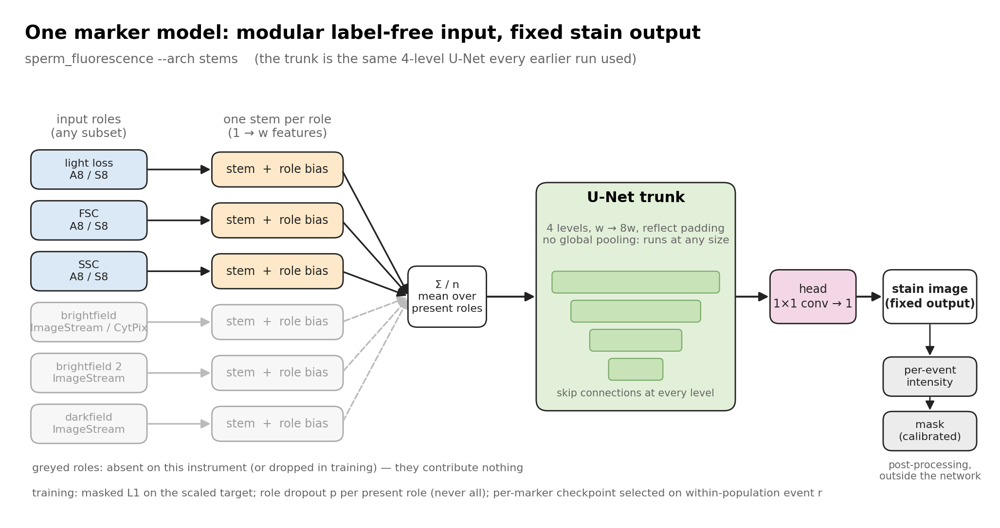
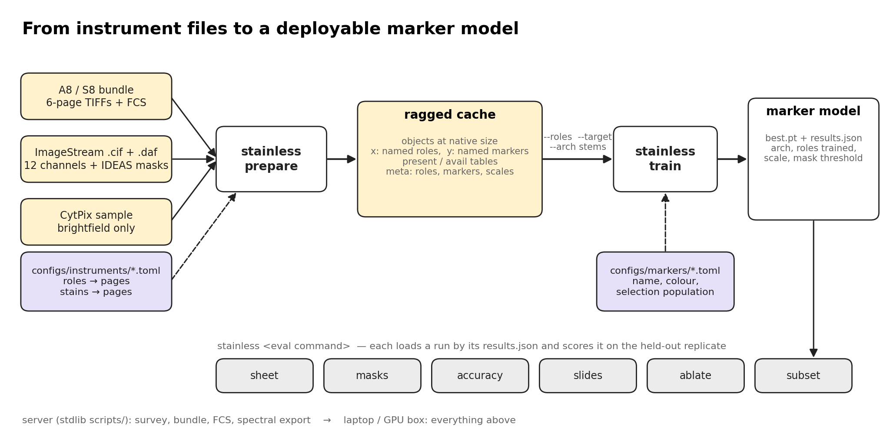
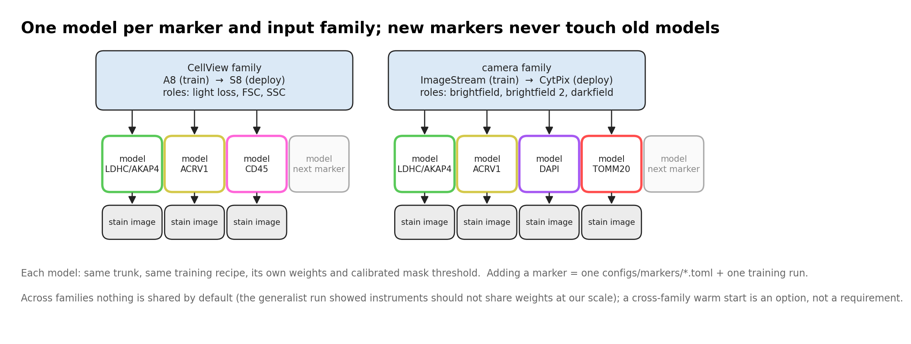

# The `sperm_fluorescence` package

Label-free in, stain out. One trained model per fluorescence marker; the input is whatever
label-free views the instrument has; the output is that marker's fluorescence image, from
which a per-event intensity and an IDEAS-style mask follow. The design and the reasons for
it are in [plan_modular.md](plan_modular.md); this page is the map of the code.

```
python -m sperm_fluorescence <command>        every command takes --help

prepare      cache any instrument by its config        train     fit one model (any cache)
sheet        IDEAS-style true/predicted sheet          masks     binary stain masks, scored against IDEAS
slides       presentation panels, one object           accuracy  scatter, event-r bars, mask IoU bars
subset       re-score on DAPI-defined populations      ablate    score a stems model under role subsets
predict-cytpix  an ISX model on CytPix crops           spectral  plot a scripts/spectral_export.py JSON
views        inputs beside outputs per input subset     denoised  pixel r against a denoised measurement
compare      runs side by side, within-population r     panel     submission figure, one row per object
predict      virtual stains for a whole cache -> store   features  the feature catalogue over a store -> CSV
populate     gates, PCA, clustering, stability, galleries over a feature table
prepare-a8 / prepare-isx / prepare-generalist          the earlier fixed-layout caches (legacy)
```

## Diagrams







Rendered by `docs/diagrams/make_diagrams.py` (PNG and SVG beside it).

## Layout

| module | job |
|---|---|
| `sperm_fluorescence/io/` | readers: `a8` (bundle zips, spillover, unmix), `isx` (.cif decode), `isx_daf`, `fcs` (re-exports the stdlib readers under `scripts/`) |
| `sperm_fluorescence/data/` | `prepare` (config-driven cache writer), `cache` (ragged layout, load/open), `batching` (datasets, shape-bucketed batches, role selection, presence), `augment` |
| `sperm_fluorescence/models/` | `stems` (per-role input stems + `build`/`call` for both architectures), `unet` (the trunk), `registry` (TOML configs) |
| `sperm_fluorescence/train/` | `loop` (the training loop and `train` CLI), `losses` (masked L1, gradient term, target scale), `device` |
| `sperm_fluorescence/predict.py` | `predict`: run a model over a cache and write the virtual-stain store (`data/store.py`: predicted images, masks, IDEAS masks, cache-aligned index) |
| `sperm_fluorescence/features/` | the feature engine: `shape` (per-mask shape, several length/width definitions), `skeleton` (longest path, curvature profile, coiling), `intensity` (intensity, texture, similarity), `engine` (`features`: compartments, cross-mask geometry, quality, population labels, CSV + column docs), `validate` (our definitions vs the .daf; predicted vs reference, Bland-Altman) |
| `sperm_fluorescence/population/` | the population engine: `engine` (`populate`: gates as pandas queries, feature sets, robust standardisation, PCA by Kaiser, k-means / GMM / HDBSCAN, stability by halves and bootstraps, Fisher-ratio discriminators), `gallery` (embedding plot, per-cluster galleries) |
| `sperm_fluorescence/eval/` | `metrics` (native-size evaluate), `sheets`/`render` (IDEAS-style figures), `load` (load a run; `sheet`), `masks`, `slides`, `accuracy`, `subset`, `ablate`, `views`, `denoised`, `compare`, `panel` (submission figure: inputs, measured and predicted stains per row), `spectral` |
| `configs/instruments/` | one TOML per instrument: label-free **roles** → source page, **stains** → page, pixel pitch, class rules |
| `configs/markers/` | one TOML per marker: name, colour, localisation, the population its checkpoint is selected on |
| `scripts/` | standard-library tools for the Windows server (survey, bundles, FCS, spectral export); unchanged |
| `tests/` | synthetic-event tests: cache round trip, role selection, stems ignore absent roles, native-size eval |

## Concepts

**Roles.** A label-free input is named by what it is, not by its channel number:
`lightloss`, `fsc`, `ssc` on the CellView family (A8, S8); `brightfield`, `brightfield2`,
`darkfield` on the camera family (ImageStream, and CytPix with `brightfield` alone). A cache's
`meta.json` lists its roles in x-channel order; `<cls>_present.npy` says which roles each
object has. `--roles a,b` selects by name for training or evaluation.

**Markers.** Targets are named by marker (`LDHC/AKAP4`, `ACRV1`, ...). `<cls>_avail.npy` says
which markers each object's instrument stained; the loss, validation and scoring only touch
those. `--target NAME` trains a one-output model for one marker.

**Architectures.** `--arch stack` is the fixed-channel U-Net (every earlier run; old
checkpoints load). `--arch stems` adds one small stem per role, summed with a learned role
bias into the same trunk, so absent roles contribute nothing; `--role-dropout P` trains one
model to serve any subset, and `sperm_fluorescence ablate` scores it under each.

**Cache.** Ragged: every object at its own size, padded to a multiple of 8 with its own
background, stored flat with shapes and offsets; batches are built from like-shaped objects
and evaluation crops predictions back to the object. Targets are background-subtracted and
scaled per instrument and marker to unit mean magnitude (`meta.scales`); inputs are
standardised per object and channel. The A8 is resampled 1.25× to the ImageStream pitch.

**Selection and scoring.** Checkpoints are chosen on a held-out slice of the training
replicate, never on the test replicate. The honest number is event r *within* one
population (well type on the A8; sperm / round / dim by the DAPI scalar on the ISX), which
cannot be earned by recognising the cell type.

## Adding things

- **A marker:** write `configs/markers/<name>.toml`, make sure the instrument config maps it
  to a page, `prepare` a cache, `train --target NAME`. Nothing else changes.
- **An instrument:** write `configs/instruments/<name>.toml` with its roles and stains, add a
  reader in `sperm_fluorescence/data/prepare.py` (`READERS`) that yields `(cls, [(x, y, scalar), ...])`,
  and it joins every command.
- **An input family model:** `prepare` the family's instruments into one cache and train
  with `--arch stems --role-dropout 0.3`; `ablate` reports what each view is worth.

## Working practice

Develop on the laptop sample (`data/a8_bundle_seed0.zip`, `data/isx/`); run full-scale on the
Windows server by PowerShell, where `scripts/` must stay standard-library; copy data by hand;
never commit `runs/`, `figures/`, `data/` or checkpoints.
